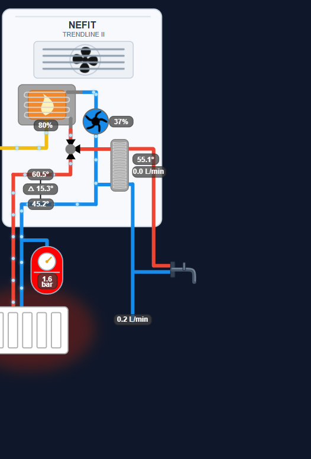

# Combi Boiler Visual Card

An animated schematic of a combi boiler installation for Home Assistant, driven by live
sensor data: temperatures, ΔT, pressure, DHW temperature and flow, water meter flow,
pump modulation and burner power.

- Animated pipe flow, spinning pump and fan, glowing radiator and coloured burner.
- Choose entities in the visual card editor or configure them in YAML; unused entities
  fall back to sensible defaults.
- Change the boiler brand and model labels in the visual editor or YAML.
- The ΔT badge can be hidden in the editor or with `show_delta_temperature: false`.
- Tap a value badge to open the more-info dialog.
- No dependencies, no `button-card` required.

See the [README](README.md) for configuration details.
