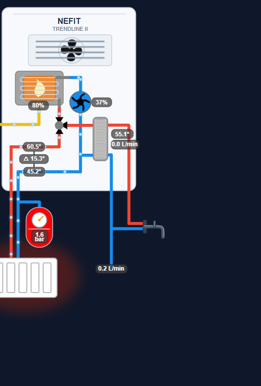

# Combi Boiler Visual Card

An animated schematic of a combi boiler installation for Home Assistant, driven by live
sensor data: temperatures, ΔT, pressure, DHW temperature and flow, water meter flow,
pump modulation and burner power.

- Animated pipe flow, spinning pump and fan, glowing radiator and coloured burner.
- All entities are configurable, unused ones fall back to sensible defaults.
- Tap a value badge to open the more-info dialog.
- No dependencies, no `button-card` required.

See the [README](README.md) for configuration details.
